<!-- Generated by tools/render-readme.mjs. Edit the renderer, tools/readme-content.mjs or data/references.json. -->
<div align="center">
  <a href="https://PhysicalWorldAgent.github.io/">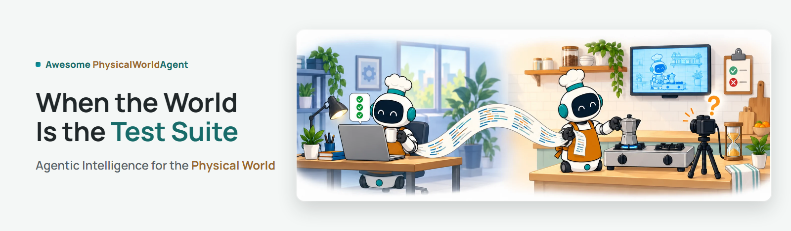</a>

  <p><strong><em>⭐ Star us if you find this useful!</em></strong></p>

  <a href="https://PhysicalWorldAgent.github.io/"></a>
  <a href="#references"></a>
  <a href="https://awesome.re"></a>

  <p>Kaixin&nbsp;Li<sup>1</sup> · Meng&nbsp;Luo<sup>1</sup> · Yanlin&nbsp;Li<sup>1</sup> · Yuchen&nbsp;Tian<sup>2</sup> · Xiang&nbsp;Liu<sup>1</sup> · Xiangru&nbsp;Jian<sup>3</sup> · Yan&nbsp;Yang<sup>4</sup> · Zhiheng&nbsp;Xi<sup>5</sup> · Yang&nbsp;Zhang<sup>1</sup> · Ziyang&nbsp;Luo<sup>2</sup> · Mingfei&nbsp;Cheng<sup>6</sup> · Hongzhan&nbsp;Lin<sup>1†</sup></p>
  <p><sub><sup>1</sup>&nbsp;NUS &nbsp;·&nbsp; <sup>2</sup>&nbsp;HKBU &nbsp;·&nbsp; <sup>3</sup>&nbsp;UWaterloo &nbsp;·&nbsp; <sup>4</sup>&nbsp;ANU &nbsp;·&nbsp; <sup>5</sup>&nbsp;Fudan &nbsp;·&nbsp; <sup>6</sup>&nbsp;SMU</sub></p>
  <p><sub>† Corresponding author</sub></p>
</div>

<picture><source media="(prefers-color-scheme: dark)" srcset="assets/readme/icons/about-dark.svg"><source media="(prefers-color-scheme: light)" srcset="assets/readme/icons/about-light.svg"></picture>

## About the survey

Coding agents built to repair software now write, test, and repair programs for robots. Unlike in software, the test suite does not come with the code: whether a robot program works must be established by running it on a robot, in a physics simulator, or through the policies it helps to train. This survey examines this emerging area, *agentic intelligence for the physical world*, by treating the world as the program's test suite.

We locate each program along two axes: where it sits relative to the actuator, from programs that act or orchestrate learned policies to programs that write rewards and build training worlds, and what judges it, from simulator predicates and learned judges to humans and physical outcomes. Drawing on software engineering, we identify which of its practices transfer to physical agents and which break, and argue that progress will depend less on writing better programs than on building a physical counterpart of *continuous integration*.

> [!IMPORTANT]
> **What the survey finds.**
>
> - **Programs are cheap; evidence is not.** Along both axes, the same bottleneck appears: producing a program is becoming cheap, while obtaining trustworthy evidence about what it does remains costly and error-prone.
> - **Programs win where policies are known to be weak.** Comparisons that favor programs over end-to-end policies cover mainly changes in task structure; demonstration-trained policies keep their in-distribution advantage in most reported comparisons.
> - **Every judge errs, and search amplifies it.** Each kind of judge in current use has documented failure modes, and optimizing against a learned judge can amplify its errors.
> - **Libraries can improve on average while tasks regress.** A skill library keeps whatever its acceptance test lets through, and current reports rarely state the cost, variance, judge visibility, judge error, or sim-to-real link needed to tell gains from regressions.

<p align="center">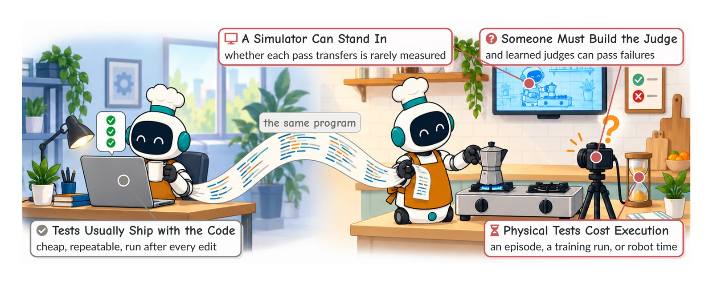</p>
<p align="center"><sub><b>Figure 1. Same program, different test suite.</b> In software, the test suite usually ships with the code and returns a cheap, repeatable result. Once the program acts in the physical world, someone must build the judge, a simulator can stand in for the robot, and every physical test has to be paid for in execution.</sub></p>

<picture><source media="(prefers-color-scheme: dark)" srcset="assets/readme/icons/questions-dark.svg"><source media="(prefers-color-scheme: light)" srcset="assets/readme/icons/questions-light.svg"></picture>

## Research questions

| | Question | What it asks |
| :-: | --- | --- |
| **RQ1** | **What do programs buy an agent that acts in the physical world, and what do they cost?** | Where in the stack should the program sit, when does it outperform an end-to-end policy, and how should the two be combined? |
| **RQ2** | **When the world is the test suite, how do agents learn that a program is wrong, and how far can that signal be trusted?** | What do traces, judges, simulators, and formal checks contribute, and what replaces physical trial when trial is not allowed? |
| **RQ3** | **How does validated experience accumulate, and what shows that progress is real?** | When do skill libraries help or hurt, how far does their content transfer, and what must be reported for a result to be interpretable? |

The survey makes four contributions:

1. **Two coordinates for every program:** where it sits relative to the actuator and what judges it, used to compare representative systems from action code to generated training worlds.
2. **A comparison of programs with end-to-end policies** across the reported studies, with what traces, judges, simulators, and formal checks can each establish about a program, and the documented failure modes of every kind of judge.
3. **An account of how accepted programs become retained experience,** in skill libraries and in model weights, and five quantities needed to tell progress from regression that current reports rarely state.
4. **A transfer analysis from software testing** of which practices carry over to physical tests and which break, with open problems each paired with a first experiment.

<p align="center">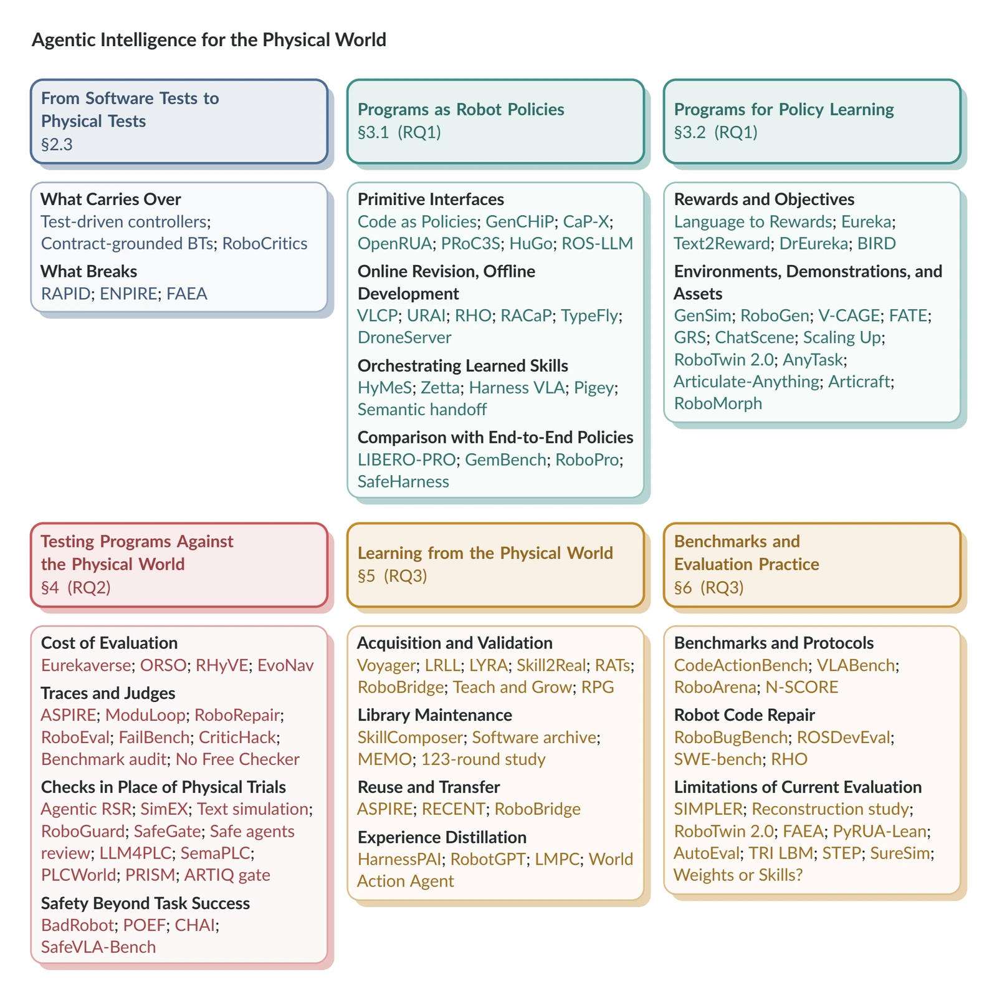</p>
<p align="center"><sub><b>Figure 3. Organization of the article and representative work.</b> Each panel is one part of the article and lists representative work discussed there.</sub></p>

<details>
<summary><b>Survey outline</b></summary>

| § | Chapter | Covers |
| :-: | --- | --- |
| 1 | **Introduction** | A coding agent and a moka pot · Related reviews · Contributions |
| 2 | **The Physical World as a Test Suite** | Scope and definitions · From language models to coding agents · Program roles and evaluation sources · From software tests to physical tests |
| 3 | **Writing Programs for the Physical World** | Programs as robot policies: primitive interfaces, online revision and offline development, orchestration of learned skills, comparison with end-to-end policies · Programs for policy learning: reward functions, training environments, demonstrations, and assets |
| 4 | **Testing Programs Against the Physical World** | Cost of evaluation · Traces and judges · Checks in place of physical trials · Safety beyond task success |
| 5 | **Learning from the Physical World** | Skill acquisition and validation · Skill maintenance and transfer · Experience distillation into model weights |
| 6 | **Benchmarks and Evaluation Practice** | Benchmarks and protocols · Benchmarks for robot code repair · Limitations of current evaluation |
| 7 | **Challenges and Future Directions** | Program representation and policy integration · Verification reliability and efficiency · Continual learning and skill maintenance · Evaluation reproducibility and real-world validity |
| 8 | **Conclusion** |  |
| A | **Representative Systems by Program Role and Evaluation Source** |  |

</details>

<picture><source media="(prefers-color-scheme: dark)" srcset="assets/readme/icons/guide-dark.svg"><source media="(prefers-color-scheme: light)" srcset="assets/readme/icons/guide-light.svg"></picture>

## Repository guide

<p align="center">
  <a href="#about-the-survey"><picture><source media="(prefers-color-scheme: dark)" srcset="assets/readme/card-about-dark.svg"><source media="(prefers-color-scheme: light)" srcset="assets/readme/card-about-light.svg"></picture></a>
  <a href="#research-questions"><picture><source media="(prefers-color-scheme: dark)" srcset="assets/readme/card-questions-dark.svg"><source media="(prefers-color-scheme: light)" srcset="assets/readme/card-questions-light.svg"></picture></a>
  <a href="#writing-programs"><picture><source media="(prefers-color-scheme: dark)" srcset="assets/readme/card-harness-dark.svg"><source media="(prefers-color-scheme: light)" srcset="assets/readme/card-harness-light.svg"></picture></a>
  <br>
  <a href="#testing-programs"><picture><source media="(prefers-color-scheme: dark)" srcset="assets/readme/card-evaluation-dark.svg"><source media="(prefers-color-scheme: light)" srcset="assets/readme/card-evaluation-light.svg"></picture></a>
  <a href="#learning-from-the-world"><picture><source media="(prefers-color-scheme: dark)" srcset="assets/readme/card-benchmarks-dark.svg"><source media="(prefers-color-scheme: light)" srcset="assets/readme/card-benchmarks-light.svg"></picture></a>
  <a href="#open-problems"><picture><source media="(prefers-color-scheme: dark)" srcset="assets/readme/card-problems-dark.svg"><source media="(prefers-color-scheme: light)" srcset="assets/readme/card-problems-light.svg"></picture></a>
</p>

<p align="center"><a href="#the-world-as-the-test-suite">The world as the test suite</a> &nbsp;·&nbsp; <a href="#references">References</a> &nbsp;·&nbsp; <a href="#contributing">Contributing</a> &nbsp;·&nbsp; <a href="#contributors">Contributors</a> &nbsp;·&nbsp; <a href="#citation">Citation</a> &nbsp;·&nbsp; <a href="#star-history">Star history</a> &nbsp;·&nbsp; <a href="#repository-layout">Repository layout</a></p>

<p align="center"><sub>Survey resources: <a href="https://github.com/PhysicalWorldAgent/Awesome-PhysicalWorldAgent">Awesome-PhysicalWorldAgent</a> &nbsp;·&nbsp; Website: <a href="https://github.com/PhysicalWorldAgent/PhysicalWorldAgent.github.io">PhysicalWorldAgent.github.io</a></sub></p>

---

<picture><source media="(prefers-color-scheme: dark)" srcset="assets/readme/icons/projects-dark.svg"><source media="(prefers-color-scheme: light)" srcset="assets/readme/icons/projects-light.svg"></picture>

## The world as the test suite

The subject is work in which a model writes or edits a program whose effects are evaluated through physical execution: on a robot, in a physics simulator, or through a policy trained with the program's output. A model writes a program, the program runs in physical dynamics, a judge decides from what happened whether it succeeded, and that result either guides a repair or adds the program to a skill library that later programs reuse.

<p align="center">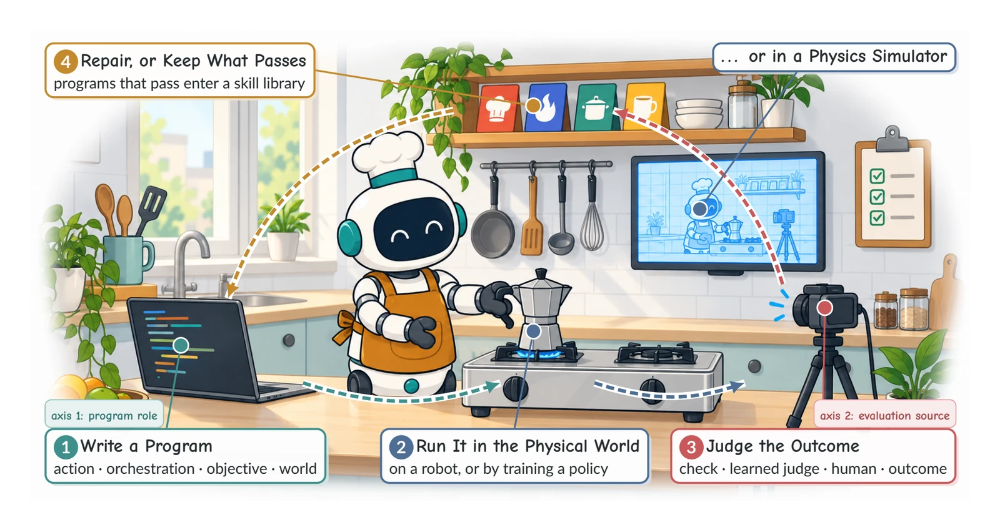</p>
<p align="center"><sub><b>Figure 2. When the world is the test suite.</b> The kitchen robot of this article writes a program to put a moka pot on the stove (1), runs it (2), has the outcome judged (3), and repairs the program or keeps what passes (4). The two tags mark the program role and the evaluation source.</sub></p>

<p align="center">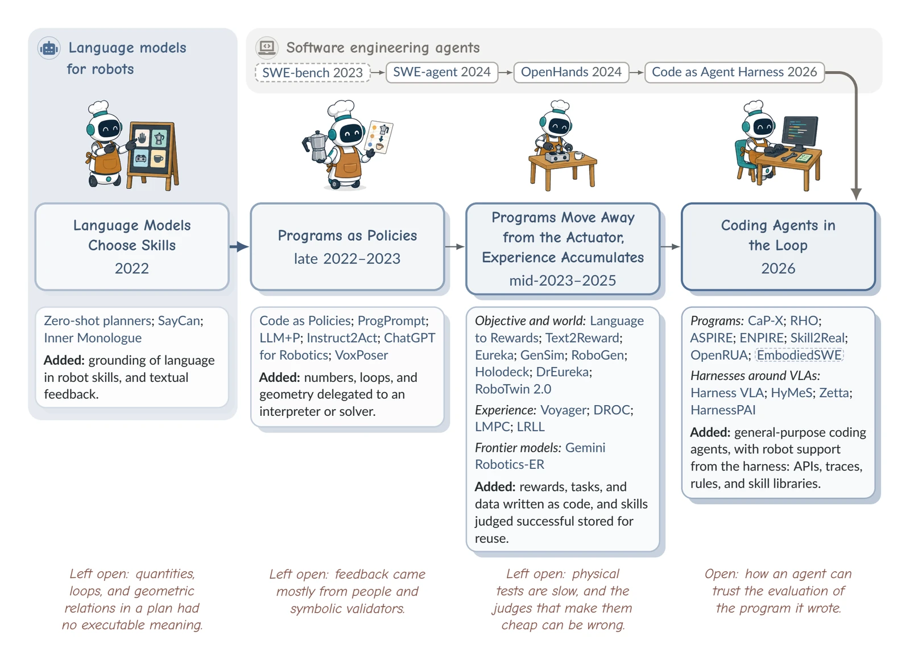</p>
<p align="center"><sub><b>Figure 4. Four phases of agentic intelligence for the physical world.</b> Two lines of work meet here. Language models for robots moved from choosing skills to writing programs whose effects are judged through physical execution, and general-purpose coding agents from software engineering joined this line in 2026. Dashed outlines mark benchmarks.</sub></p>

Each step of this loop has a counterpart in software engineering, where a test suite usually comes with the repository and the agent can run it after every edit. Treating the physical world as the test suite means asking, at every step, what the world supplies in place of a test.

<p align="center">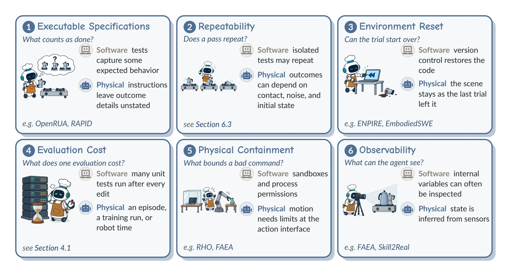</p>
<p align="center"><sub><b>Figure 5. Where software assumptions need support in the physical world.</b> A physical task needs an explicit success criterion (1), an account of how outcomes vary between trials (2), a reset procedure (3), a budget for costly tests (4), limits on unsafe commands at the action interface (5), and a statement of what the agent can observe (6).</sub></p>

**Software-engineering practices that transfer to physical agents.**

| In software | Physical counterpart | Examples |
| --- | --- | --- |
| **Agent harness** | Harness that sets the robot interface, the feedback, and access to privileged state | ASPIRE, RHO, OpenRUA |
| **Stack trace and logs** | Per-primitive traces with keyframes and overlays | ASPIRE |
| **Repository and refactoring** | Multi-file policy repositories and rebinding skills to a new body | RHO, RECENT |
| **Executable behavioral tests** | Symbolic trace properties and controller test suites in simulation | RoboEval, test-driven framework |
| **Regression gate** | Practice suites and paired comparisons before accepting a skill or harness edit | RPG, Skill2Real, HexaAnything |
| **Contracts** | Skill schemas, allowed operators, and encoded safety constraints | Contract-grounded BTs, SafeGate |
| **Hidden tests** | Verifiers never returned to the agent and grading in a separate environment | CodeActionBench, EmbodiedSWE |

<p align="right"><sub><a href="#repository-guide">↑ Back to guide</a></sub></p>

<picture><source media="(prefers-color-scheme: dark)" srcset="assets/readme/icons/harness-dark.svg"><source media="(prefers-color-scheme: light)" srcset="assets/readme/icons/harness-light.svg"></picture>

## Writing programs

Programs differ in where they sit relative to the actuator. Some act on the robot directly or orchestrate learned skills; others write the rewards, environments, demonstrations, and assets from which a policy learns.

<p align="center">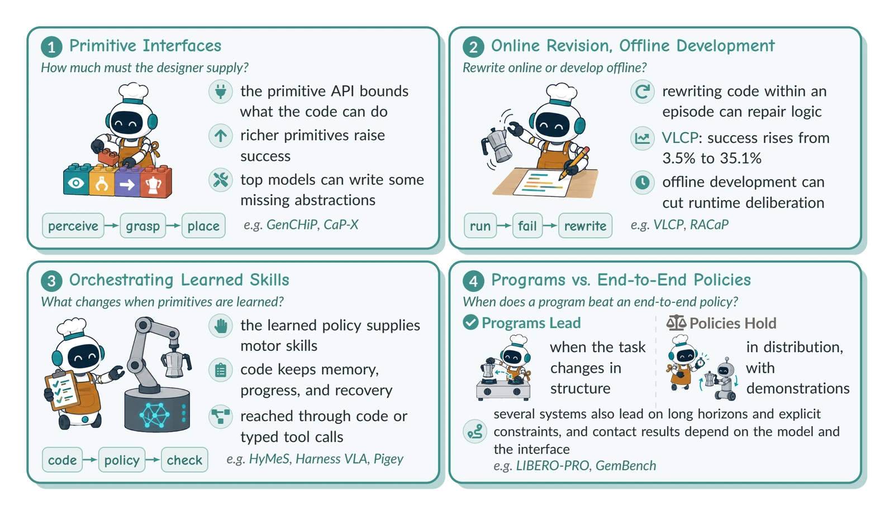</p>
<p align="center"><sub><b>Figure 6. Programs as robot policies: four questions.</b> What a program can call (1), when it is revised during an episode or developed offline (2), how it coordinates learned skills (3), and when it outperforms an end-to-end policy (4).</sub></p>

> [!NOTE]
> **Execution feedback pays.** In ASPIRE's ablation on LIBERO-PRO, an execution engine and a skill library together raise macro-average success from 14% to 62%. The engine records perception and control calls, exposes images before and after them, and re-runs candidate repairs. Evolutionary search then adds another 10 percentage points.

<p align="center">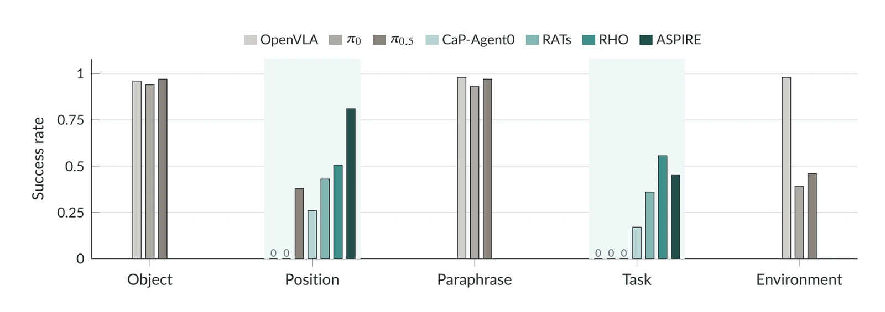</p>
<p align="center"><sub><b>Figure 7. What the code-versus-VLA comparisons on LIBERO-PRO cover.</b> Results on the Goal suite. Gray bars show OpenVLA, π₀, and π₀.₅ under LIBERO-PRO&#39;s five perturbations. Under its released evaluation code, a VLA receives the original instruction in the paraphrase and task conditions. Colored bars show program-based methods, which report results only under the position and task perturbations (shaded): CaP-Agent0 from CaP-X, RATs, RHO, and ASPIRE with Opus 4.6.</sub></p>

<p align="center">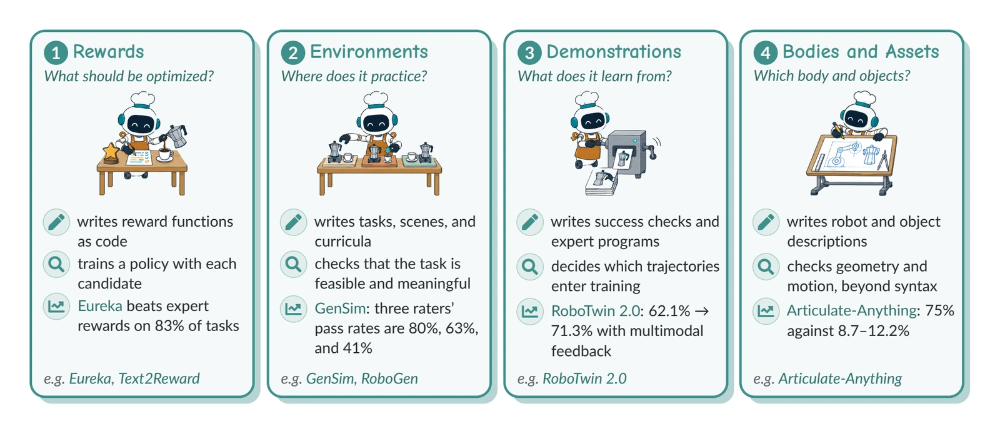</p>
<p align="center"><sub><b>Figure 8. Programs for policy learning.</b> A reward program shapes what a policy learns (1), and programs that build environments, demonstrations, bodies, and assets shape the conditions in which it learns (2–4).</sub></p>

<p align="right"><sub><a href="#repository-guide">↑ Back to guide</a></sub></p>

<picture><source media="(prefers-color-scheme: dark)" srcset="assets/readme/icons/evaluation-dark.svg"><source media="(prefers-color-scheme: light)" srcset="assets/readme/icons/evaluation-light.svg"></picture>

## Testing programs

Whether a program works has to be established by running it, and that evidence can be both costly and wrong. A result may need an episode, a training run, or hardware: a full Eurekaverse run costs about 15 US dollars in language-model calls and a day on eight A6000 GPUs.

<p align="center">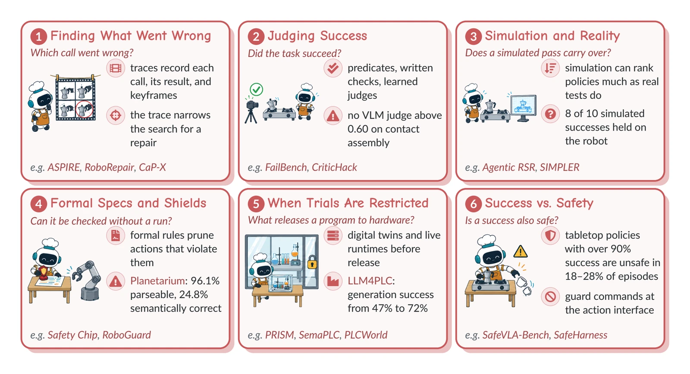</p>
<p align="center"><sub><b>Figure 9. How an agent learns that a program is wrong.</b> A trace locates the failing call (1), a judge decides whether the outcome counts as success (2), and simulation tests the program in place of the robot (3). Formal specifications check a program before it runs (4), other checks decide its release when physical trials are restricted (5), and a successful run can still be unsafe (6).</sub></p>

> [!WARNING]
> **Judges make mistakes.** On FailBench, the best of thirteen detectors based on vision-language models reaches a macro-averaged balanced accuracy of only 0.77 when judging manipulation outcomes. In OpenRUA's analysis of failed episodes, about a quarter involve a success condition absent from the instruction or a predicate that contradicts it.

<p align="center">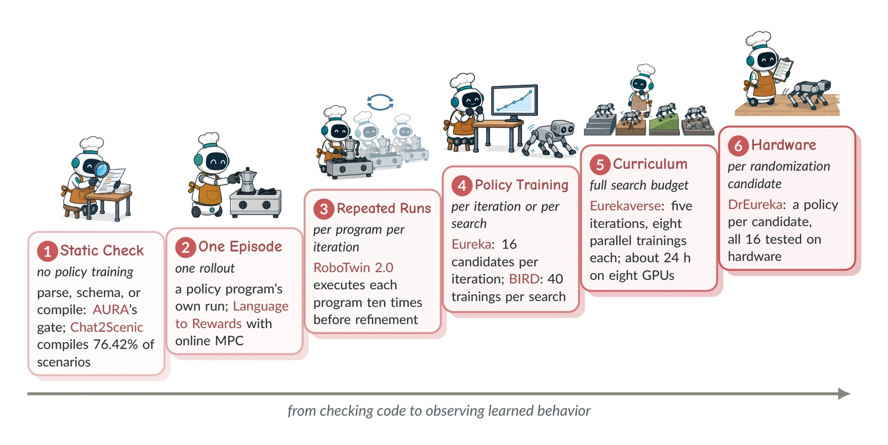</p>
<p align="center"><sub><b>Figure 10. Evaluation paths for different kinds of programs.</b> Evaluation ranges from checking code to training and testing the behavior it induces. Examples from the reviewed work report budgets per execution, per candidate, or per complete search.</sub></p>

<p align="right"><sub><a href="#repository-guide">↑ Back to guide</a></sub></p>

<picture><source media="(prefers-color-scheme: dark)" srcset="assets/readme/icons/benchmarks-dark.svg"><source media="(prefers-color-scheme: light)" srcset="assets/readme/icons/benchmarks-light.svg"></picture>

## Learning from the world

Accepted programs become retained experience, in skill libraries and in model weights. Persistence also makes errors durable: a library keeps whatever its acceptance test lets through, so that test decides which gains and which regressions are retained.

<p align="center">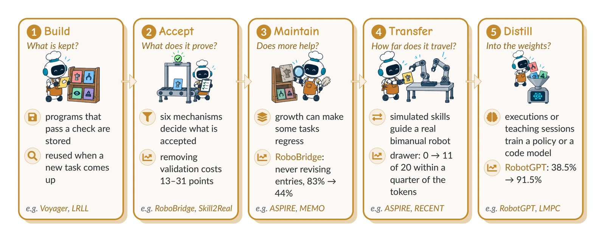</p>
<p align="center"><sub><b>Figure 11. What happens to a program that passes its checks.</b> It is stored in a library (1), often after a further acceptance test (2). The library then has to be maintained (3), and its skills may carry over to new robots, models, or tasks (4). Verified executions can also train a model&#39;s weights (5).</sub></p>

<p align="center">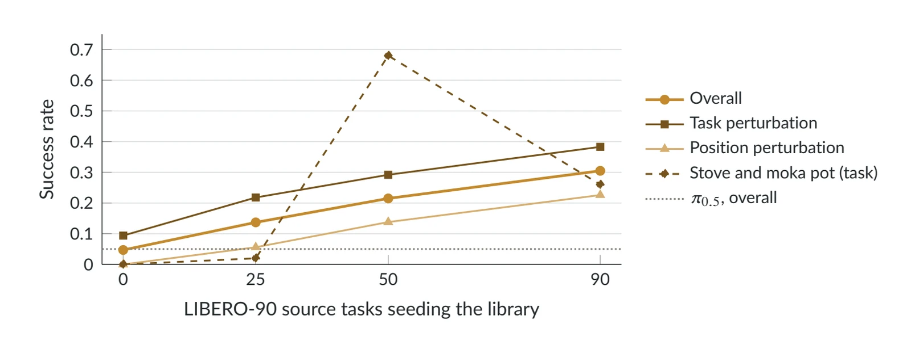</p>
<p align="center"><sub><b>Figure 12. What a growing skill library buys, and where it hurts.</b> Zero-shot success of ASPIRE with Opus 4.6 on LIBERO-PRO Long with skill libraries seeded from increasing numbers of LIBERO-90 source tasks. The dotted line is π₀.₅ on the same benchmark. Average success rises with the library, while the task of turning on the stove and placing the moka pot, under task perturbation, falls from 0.68 to 0.26 between 50 and 90 source tasks.</sub></p>

**What reports should state.** Five quantities are needed to tell progress from regression, and current reports rarely give them.

| Quantity | What to report |
| --- | --- |
| **Cost** | Model calls, GPU time, robot time, and human intervention, stated separately |
| **Variance** | How results spread across seeds and repeated runs |
| **Judge visibility** | Which checks and results the agent can see during development |
| **Judge error** | How often the judge accepts failures or rejects successes |
| **Sim-to-real link** | Whether simulated results hold in the real setting |

<p align="right"><sub><a href="#repository-guide">↑ Back to guide</a></sub></p>

<picture><source media="(prefers-color-scheme: dark)" srcset="assets/readme/icons/problems-dark.svg"><source media="(prefers-color-scheme: light)" srcset="assets/readme/icons/problems-light.svg"></picture>

## Open problems

Progress will depend less on writing better programs than on building a physical counterpart of continuous integration: verification cheap enough to run often, reliable enough to trust under search, and maintained alongside the experience it validates.

<p align="center">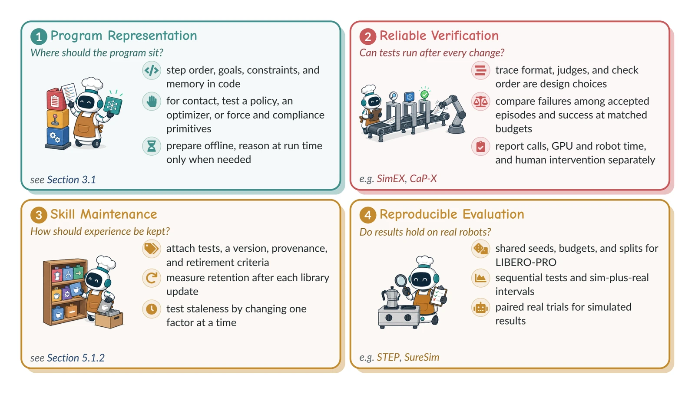</p>
<p align="center"><sub><b>Figure 13. Four challenges and future directions.</b> How to divide a task between programs and learned policies (1), how verification can become reliable at a known cost (2), how skill libraries stay useful as the world changes (3), and how evaluation can be reproduced and checked against real robots (4).</sub></p>

| Open problem | Findings so far | First experiment |
| --- | --- | --- |
| **Physical continuous integration** | Existing trace-and-library loops, judge audits, and simulator studies motivate joint evaluation of reliability and cost | Compare verification and acceptance procedures at matched search budgets, then audit accepted episodes and measure held-out success, retention, and cost |
| **Judges robust to search** | Optimizing against a learned reward model can amplify wrong-object failures | Audit accepted programs from matched searches with and without verifier feedback, using independent outcome checks |
| **Code versus VLA on all splits** | The code–VLA comparisons in Figure 7 cover only the LIBERO-PRO position and task splits | Run program-based methods on the object, paraphrase, and environment splits with re-run VLA baselines |
| **Staleness and retention** | Library growth gives non-monotonic per-task transfer; no robot study reviewed re-tests the entries of a stored skill library after a controlled one-factor change | Hold the library fixed and change one world or API factor before adaptation, then measure surviving success separately from retention after library updates |
| **Interface for orchestration** | Most harnesses adopt one interface; reported preferences between code and typed calls depend on the model and the setting | Compare code and typed calls on the same composition tasks and budgets, and repeat runs to measure uncertainty |
| **Postconditions for learned skills** | VLA skills competent from clean starts stall when chained | Learn or check postconditions per skill, then measure chained success |
| **Cheap evaluations that hold early** | Forked reward comparisons are unreliable before the policy is competent, and longer forks help at higher cost | Measure agreement of each proxy with full training at each stage of a reward search |
| **Code or weights** | Programs teach VLAs, and at matched development time the student matches its code teachers where demonstrations are plentiful | Represent the same knowledge as code, documents, or weights at matched data and compute, then measure reuse and revision cost |
| **Issue-driven robot-software repair** | RoboBugBench grades repairs of 33 real Nav2 defects in Gazebo, and its audit shows the oracle passing counterfeit patches | Extend audited behavioral oracles to more ROS 2 repositories, with paired regression scenarios, hidden checks, a record of the judge and budget, and real-robot confirmation |
| **Judging under injection** | Scene text can hijack embodied agents | Place adversarial text in scenes judged by a VLM verifier of robot programs |

> *If the physical world is to serve as the test suite, its tests must be tested as well.*

<p align="right"><sub><a href="#repository-guide">↑ Back to guide</a></sub></p>

<picture><source media="(prefers-color-scheme: dark)" srcset="assets/readme/icons/references-dark.svg"><source media="(prefers-color-scheme: light)" srcset="assets/readme/icons/references-light.svg"></picture>

## References

326 bibliographic records cited by the survey, ordered from newest to oldest. Badges give the venue or record type.

| Conference | Journal | Preprint | Book | Other |
| ---: | ---: | ---: | ---: | ---: |
| 11 | 3 | 312 | 0 | 0 |

    

[2027](#year-2027) | [2026](#year-2026) | [2025](#year-2025) | [2024](#year-2024) | [2023](#year-2023) | [2022](#year-2022)

<a id="year-2027"></a>

### 2027

- Evaluating LLMs in ROS Robotic Software Code Generation. [[paper](<https://doi.org/10.1007/s10664-026-10910-7>)] 

<a id="year-2026"></a>

<details>
<summary><strong>2026</strong> &middot; 168 references</summary>

- A Benchmark Suite and Ground-Truth Methodology for Formal Verification of IEC 61131-3 Ladder Diagram Programs. [[paper](<https://arxiv.org/abs/2609.18994>)] 
- A Bird's-Eye View of Iterative Reward Design. [[paper](<https://arxiv.org/abs/2610.04364>)] 
- A hardware-safety-gated system for LLM-written native ARTIQ control code on a trapped-ion platform. [[paper](<https://arxiv.org/abs/2606.27231>)] 
- ABC-Bench: An Agentic Bio-Capabilities Benchmark for Biosecurity. [[paper](<https://arxiv.org/abs/2606.11150>)] 
- Addressing the Orchestration Gap in Generalist Robots via Physical Agency. [[paper](<https://arxiv.org/abs/2607.21725>)] 
- AEGIS: Assay-Aware Protocol Validation and Runtime Monitoring for Open-Source Liquid Handling Robots. [[paper](<https://arxiv.org/abs/2607.15620>)] 
- Agent as Policy for Robotic Manipulation. [[paper](<https://arxiv.org/abs/2609.12541>)] 
- Agentic RSR: Real-to-Sim-to-Real through Scene Reconstruction and Execution-Grounded Robot Policies. [[paper](<https://arxiv.org/abs/2610.10479>)] 
- AgenticRoboRL: Bringing Coding-Agent Post-Training to Agentic Robotics. [[paper](<https://arxiv.org/abs/2610.28589>)] 
- AI for Games in the Foundation Model Era. [[paper](<https://arxiv.org/abs/2609.16679>)] 
- ALRM: Agentic LLM for Robotic Manipulation. [[paper](<https://arxiv.org/abs/2601.19510>)] 
- An LLM-Agnostic, MAVLink-Based Drone Command and Control Interface and Agentic Harness Using the Model Context Protocol. [[paper](<https://arxiv.org/abs/2601.15486>)] 
- An Unexpected Robot Policy: Early Evaluations of GPT-6 Astra on RoboDojo and Beyond. [[paper](<https://arxiv.org/abs/2609.24170>)] 
- AnyRank: Reliable Anytime Policy Ranking via Sequential Testing. [[paper](<https://arxiv.org/abs/2610.14603>)] 
- AquaCap: A Training-Free Underwater Embodied Agent with Code-as-Policy. [[paper](<https://arxiv.org/abs/2609.23133>)] 
- Articraft: An Agentic System for Scalable Articulated 3D Asset Generation. [[paper](<https://arxiv.org/abs/2605.15187>)] 
- ASPIRE: Agentic /Skills Discovery for Robotics. [[paper](<https://arxiv.org/abs/2607.00272>)] 
- Beyond Binary Success: Sample-Efficient and Statistically Rigorous Robot Policy Comparison. [[paper](<https://arxiv.org/abs/2603.13616>)] 
- BiGym 2.0: Benchmarking Learned and Agent-Developed Policies for Humanoid Household Manipulation. [[paper](<https://arxiv.org/abs/2610.07594>)] 
- BTGenBot-2: Efficient Behavior Tree Generation with Small Language Models. [[paper](<https://arxiv.org/abs/2602.01870>)] 
- Can a Frontier VLM Serve as a Robot Policy for Memory-Dependent Manipulation? [[paper](<https://arxiv.org/abs/2610.17350>)] 
- CaP-X: A Framework for Benchmarking and Improving Coding Agents for Robot Manipulation. [[paper](<https://arxiv.org/abs/2603.22435>)] 
- Causal Reward World Models: Zero-shot Reward Design for Automated Skill Generation. [[paper](<https://arxiv.org/abs/2606.23280>)] 
- Chat2Scenic: An Iterative RAG-Based Framework for Scenario Generation in Autonomous Driving. [[paper](<https://arxiv.org/abs/2607.14387>)] 
- Co-Evolving Robot Orchestrators and Policies through Deployment. [[paper](<https://arxiv.org/abs/2610.09228>)] 
- Code as Agent Harness. [[paper](<https://arxiv.org/abs/2605.18747>)] 
- Code as Worlds: Agentic Discovery of Executable World Representations for Physical Reasoning. [[paper](<https://arxiv.org/abs/2608.27549>)] 
- CodeActionBench: Evaluating Agentic Code-as-Policy for Embodied Manipulation. [[paper](<https://arxiv.org/abs/2609.33807>)] 
- CodeGraphVLP: Code-as-Planner Meets Semantic-Graph State for Non-Markovian Vision-Language-Action Models. [[paper](<https://arxiv.org/abs/2604.22238>)] 
- Coding Agents for Generalized Task and Motion Planning Problems. [[paper](<https://arxiv.org/abs/2609.30233>)] 
- Coding Agents with Harness for Safe Robot Control. [[paper](<https://arxiv.org/abs/2609.20822>)] 
- Contract-Grounded Behavior Tree Synthesis via Coding Agents. [[paper](<https://arxiv.org/abs/2607.12220>)] 
- Coordinated Control of Multiple Construction Machines Using LLM-Generated Behavior Trees with Flag-Based Synchronization. [[paper](<https://arxiv.org/abs/2602.01041>)] 
- CriticHack: Evaluating Visual Rewards Under Robot Policy Optimization. [[paper](<https://arxiv.org/abs/2610.02527>)] 
- Demonstration-Free Robotic Control via LLM Agents. [[paper](<https://arxiv.org/abs/2601.20334>)] 
- DiagGen: Agentic Generation of Deformable Assets with Sim-based Diagnostics for Robotic Simulation. [[paper](<https://arxiv.org/abs/2609.23103>)] 
- Diagnosing Semantic Handoff Failures in Agent-Orchestrated Vision-Language-Action Skill Composition. [[paper](<https://arxiv.org/abs/2607.06256>)] 
- Dialectical Structured Reasoning for Explainable Multimodal Fake News Detection. [[paper](<https://aclanthology.org/2026.findings-acl.1601/>)] 
- DiffCoT: Diffusion-styled Chain-of-Thought Reasoning in LLMs. [[paper](<https://aclanthology.org/2026.findings-acl.1939/>)] 
- Don't Drop the BATON: Long-Horizon Robot Manipulation via Agentic Subtask Exploration and Transition-aware Memory. [[paper](<https://arxiv.org/abs/2608.16889>)] 
- DynaHarness: A Dynamic Physical Harness for Self-Evolving Robot Agents. [[paper](<https://arxiv.org/abs/2609.40306>)] 
- Efficient Skill Grounding via Code Refactoring with Small Language Models. [[paper](<https://arxiv.org/abs/2606.07999>)] 
- ELEVATE: Agentic Controller Acquisition from Task Failure for Quadrupedal Manipulation. [[paper](<https://arxiv.org/abs/2610.38388>)] 
- Embodied Skill Bench: Benchmarking How Well Agents with Embodied Skills Perform on Physical Tasks. [[paper](<https://arxiv.org/abs/2610.16238>)] 
- Embodied Turing Machines: Stateful Code for Robot Recursive Self-Improvement. [[paper](<https://arxiv.org/abs/2610.12369>)] 
- EmbodiedEvo: Self-Evolving Coding Agent for Physical Intelligence. [[paper](<https://arxiv.org/abs/2610.18867>)] 
- EmbodiedRSI: Active Continual Robot Learning Through Hypothesis-Guided Co-Evolution. [[paper](<https://arxiv.org/abs/2610.10498>)] 
- EmbodiedSWE: Coding Agents for Long Horizon Dexterous Robotics. [[paper](<https://arxiv.org/abs/2609.27308>)] 
- Encore: Few-Shot Agentic Discovery of Manipulation Strategies. [[paper](<https://arxiv.org/abs/2609.37359>)] 
- EndoRSI: Physical-Evidence-Driven Recursive Improvement of Endoscopic Robot Policies. [[paper](<https://arxiv.org/abs/2610.13376>)] 
- ENPIRE: Agentic Robot Policy Self-Improvement in the Real World. [[paper](<https://arxiv.org/abs/2606.19980>)] 
- EvoNav: Evolutionary Reward Function Design for Robot Navigation with Large Language Models. [[paper](<https://arxiv.org/abs/2605.11859>)] 
- ExplainHM++: Explainable Harmful Meme Detection With Retrieval-Augmented Debate Between Large Multimodal Models. [[paper](<https://doi.org/10.1109/TKDE.2025.3637552>)] 
- Explore, Execute, Evolve: A Skill Acquisition and Reuse Loop for Embodied Agents. [[paper](<https://arxiv.org/abs/2609.37810>)] 
- FailBench: How Reliable are VLMs at Judging Robot Task Success? [[paper](<https://arxiv.org/abs/2609.03611>)] 
- Faster and Better? Benchmark Bugs and Design Limitations Distort the Evaluation of Vision-Language-Action Acceleration. [[paper](<https://arxiv.org/abs/2609.37771>)] 
- FATE: Closed-Loop Feasibility-Aware Task Generation with Active Repair for Physically Grounded Robotic Curricula. [[paper](<https://arxiv.org/abs/2603.01505>)] 
- Fewer Tokens, Better Action: GPT-6 Astra Robot Agents with 14% Higher Success Rate but 65% Fewer Tokens. [[paper](<https://arxiv.org/abs/2610.01939>)] 
- Fly-by-Code: Embodied Coding Agents for Aerial Manipulation with Active Visual and Physical Feedback. [[paper](<https://arxiv.org/abs/2610.12549>)] 
- FORCA: A Force-Aware Coding Agent for Contact-Rich Robot Manipulation. [[paper](<https://arxiv.org/abs/2610.31841>)] 
- From Demonstrations to Rewards: Test-Time Prompt Optimization for VLM Reward Models. [[paper](<https://arxiv.org/abs/2606.00083>)] 
- From Digital to Physical: Digital Agents as Autonomous Coaches for Physical Intelligence. [[paper](<https://arxiv.org/abs/2601.21570>)] 
- From Evidence to Action: How Tool-Using Agents Fail. [[paper](<https://arxiv.org/abs/2610.07753>)] 
- From LLM-Generated Specifications to Learned Quadruped Locomotion. [[paper](<https://arxiv.org/abs/2609.07111>)] 
- From Local Corrections to Generalized Skills: Improving Neuro-Symbolic Policies with MEMO. [[paper](<https://arxiv.org/abs/2603.04560>)] 
- From Rollout to Reset: A Graph-Based Harness for Autonomous Long-Horizon Manipulation Evaluation. [[paper](<https://arxiv.org/abs/2609.19413>)] 
- From Storage to Experience: A Survey on the Evolution of LLM Agent Memory Mechanisms. [[paper](<https://aclanthology.org/2026.findings-acl.2069/>)] 
- Generalizing Manipulation Skills with a Local Coding Agent. [[paper](<https://arxiv.org/abs/2609.26499>)] 
- HARBOR: A Harness Framework for Agentic Robot Reinforcement Learning. [[paper](<https://arxiv.org/abs/2606.08610>)] 
- Harness VLA: Steering Frozen VLAs into Reliable Manipulation Primitives via Memory-Guided Agents. [[paper](<https://arxiv.org/abs/2607.08448>)] 
- HarnessPAI: An Evolving Harness for Physical AI. [[paper](<https://arxiv.org/abs/2609.29166>)] 
- HexaShell: A Thin Harness for Exploring the Limits of VLM Agents as Robot Coding Agents. [[paper](<https://arxiv.org/abs/2610.23479>)] 
- Hijacking Robots with a Piece of Paper: A Systematic Study of Physical Prompt Injection in VLM-Controlled Robots. [[paper](<https://arxiv.org/abs/2608.05715>)] 
- HuGo: LLMs as Whole-Body Policy Code Designers for Humanoid Loco-Manipulation. [[paper](<https://arxiv.org/abs/2609.30594>)] 
- InCoder-32B-Thinking: Industrial Code World Model for Thinking. [[paper](<https://arxiv.org/abs/2604.03144>)] 
- InterEvolve: Test-Time Evolution of Reward Programs for Humanoid Loco-Manipulation. [[paper](<https://arxiv.org/abs/2610.02196>)] 
- Jailbreaking Embodied LLMs via Action-level Manipulation. [[paper](<https://arxiv.org/abs/2603.01414>)] 
- LEACL: LLM-Enhanced Automatic Curriculum Learning for Reinforcement Learning in Long-Horizon Manipulation Tasks. [[paper](<https://arxiv.org/abs/2607.23515>)] 
- Learning and Transferring Closed-Loop Robot Software. [[paper](<https://arxiv.org/abs/2609.19906>)] 
- Learning to Compose: Recursive Self-Improvement of Shared Executable Stacks for Zero-Shot Long-Horizon Robot Manipulation. [[paper](<https://arxiv.org/abs/2610.24464>)] 
- LIBERO-X: Robustness Litmus for Vision-Language-Action Models. [[paper](<https://arxiv.org/abs/2602.06556>)] 
- Make Code as Policy Great Again: Frontier Agents Write, Call, and Evolve Robot Tools. [[paper](<https://arxiv.org/abs/2609.39018>)] 
- Measuring Asset and Scene Reconstruction Effects in Real-to-Sim Robot Evaluation. [[paper](<https://arxiv.org/abs/2610.00731>)] 
- MEMENTO: Memory-Guided Memetic Code-as-Policy Evolution. [[paper](<https://arxiv.org/abs/2607.22832>)] 
- MimicAgent: Quadruped Skills via Prompt-to-Trajectory Generation. [[paper](<https://arxiv.org/abs/2609.24145>)] 
- MLREF: Efficient Module Reuse for Reward Design in Reinforcement Learning via Large Language Models. [[paper](<https://arxiv.org/abs/2608.18827>)] 
- ModuLoop: Low-Level Code Generation using Modular Synthesizer and Closed-Loop Debugger for Robotic Control. [[paper](<https://arxiv.org/abs/2606.03047>)] 
- No Free Checker: A Survey of Verifiers for Robot Policies. [[paper](<https://arxiv.org/abs/2609.09250>)] 
- OpenRUA: Robot-Use Agents Are Zero-Shot Visuomotor Policies. [[paper](<https://arxiv.org/abs/2610.02459>)] 
- PhyAgentOS: A Self-Evolving Operating System for Embodied Agents with Decoupled Cognitive Planning and Physical Execution. [[paper](<https://arxiv.org/abs/2607.16636>)] 
- Playful Agentic Robot Learning. [[paper](<https://arxiv.org/abs/2606.19419>)] 
- PLCWorld: Benchmarking LLM-Generated PLC Programs in Closed-Loop Plant Simulation. [[paper](<https://arxiv.org/abs/2610.02982>)] 
- PRACTICE: From Experience to Expertise in Self-Evolving Embodied Agents. [[paper](<https://arxiv.org/abs/2608.30760>)] 
- Pre-Execution Safety Gate & Task Safety Contracts for LLM-Controlled Robot Systems. [[paper](<https://arxiv.org/abs/2604.05427>)] 
- PRISM: Protocol Refinement through Intelligent Simulation Modeling. [[paper](<https://arxiv.org/abs/2601.05356>)] 
- Profiling a Frontier Agent with EBench: From Direct Control to Harness with Policy. [[paper](<https://arxiv.org/abs/2610.35832>)] 
- RACaP: Agentic Reasoning, Acting, and Coding as Policies for Evolvable Robot Learning. [[paper](<https://arxiv.org/abs/2609.29394>)] 
- RAPID: Robot Agentic Programming from Demonstrations. [[paper](<https://arxiv.org/abs/2609.30249>)] 
- Ratchet: How Reliable Must an LLM Judge Be to Retire a Skill? [[paper](<https://arxiv.org/abs/2605.22148>)] 
- RDA: Reward Design Agent for Reinforcement Learning. [[paper](<https://arxiv.org/abs/2606.01672>)] 
- RE-0: Verified Recursive Improvement of Embodied Code-as-Policy Agents through Local On-Policy Distillation. [[paper](<https://arxiv.org/abs/2609.32416>)] 
- Reconstruct, Practice, Go Real: Guided Self-Improvement for Embodied Agents. [[paper](<https://arxiv.org/abs/2610.02204>)] 
- Refuses in Chat, Complies with Arms: LLM Refusal Does Not Survive Robot Control. [[paper](<https://arxiv.org/abs/2610.14043>)] 
- Refuses When Asked, Complies When Acting: A Runtime Safety Check for Robot Control Loops. [[paper](<https://arxiv.org/abs/2610.27350>)] 
- RegenHarness: A Robot Agent Harness with Evidence-Gated Recursive Self-Improvement. [[paper](<https://arxiv.org/abs/2609.27612>)] 
- Repo2Skill-Evo: Repository Skills Go Stale in Silence. [[paper](<https://arxiv.org/abs/2608.21964>)] 
- Requirement-Bound Verified Commissioning: A Frozen Four-Billion-Parameter Local Model as a Candidate Generator under an External Acceptance Layer with Verification and Release Authority. [[paper](<https://arxiv.org/abs/2609.30219>)] 
- RESCUE: Is This Alarm Worth Acting On? Counterfactual Evaluation of VLA Runtime Monitors. [[paper](<https://arxiv.org/abs/2610.13516>)] 
- Retrieval-grounded robot program generation and simulation-based correction via Model Context Protocol. [[paper](<https://arxiv.org/abs/2608.21417>)] 
- Revisiting the "Push-T" Robot Manipulation Task with Agentic Robotics. [[paper](<https://arxiv.org/abs/2608.18227>)] 
- RHO: Your Coding Agent is Secretly a Roboticist. [[paper](<https://arxiv.org/abs/2606.16458>)] 
- RHyVE: Competence-Aware Verification and Phase-Aware Deployment for LLM-Generated Reward Hypotheses. [[paper](<https://arxiv.org/abs/2604.28056>)] 
- RLE-Bench: A Qualifying Exam for Coding Agents as Robot Learning Engineers. [[paper](<https://arxiv.org/abs/2609.34210>)] 
- RoboAuto: Autonomous Robot Program Search through Multi-Level Physical Understanding. [[paper](<https://arxiv.org/abs/2610.36533>)] 
- RoboBridge: A Self-Evolving Embodied Agent Framework for Sim-to-Real Transfer. [[paper](<https://arxiv.org/abs/2610.02717>)] 
- RoboBugBench: Benchmarking Automated Repair of Real Robot Software Under an Audited Behavioral Oracle. [[paper](<https://arxiv.org/abs/2610.16369>)] 
- RoboCritics: Enabling Reliable End-to-End LLM Robot Programming through Expert-Informed Critics. [[paper](<https://arxiv.org/abs/2603.06842>)] 
- RoboDojo: A Unified Sim-and-Real Benchmark for Comprehensive Evaluation of Generalist Robot Manipulation Policies. [[paper](<https://arxiv.org/abs/2607.04434>)] 
- RoboDuo: Attempt, Check and Atomic Recovery through Code for Vision-Language-Action Models. [[paper](<https://arxiv.org/abs/2610.34108>)] 
- RoboHarn-Evo: Evolving Hierarchical Physical Knowledge for Self-Improving Robotic Manipulation. [[paper](<https://arxiv.org/abs/2609.37583>)] 
- RoboHarness: A Simple Harness Outperforms VLA and World Action Models. [[paper](<https://arxiv.org/abs/2610.14018>)] 
- RoboJailBench: Benchmarking Adversarial Attacks and Defenses in Embodied Robotic Agents. [[paper](<https://arxiv.org/abs/2605.19328>)] 
- RoboReward: General-Purpose Vision-Language Reward Models for Robotics. [[paper](<https://arxiv.org/abs/2601.00675>)] 
- Robotic Agentic Platform for Intelligent Electric Vehicle Disassembly. [[paper](<https://arxiv.org/abs/2603.18520>)] 
- RobotWorld: Benchmarking Multimodal Agents for Robot Use Across Diverse Tasks and Embodiments. [[paper](<https://arxiv.org/abs/2610.10409>)] 
- RoboWorld: Fast and Reliable Neural Simulators for Generalist Robot Policy Evaluation. [[paper](<https://arxiv.org/abs/2607.01060>)] 
- ROSClaw: An OpenClaw ROS 2 Framework for Agentic Robot Control and Interaction. [[paper](<https://arxiv.org/abs/2603.26997>)] 
- SafeVLA-Bench: A Benchmark for the Success-Safety Gap in Vision-Language-Action Models. [[paper](<https://arxiv.org/abs/2606.00773>)] 
- Same Trajectory, Contradictory Rewards (ROBORMBENCH): Paraphrase Fragility in Vision Language Reward Models. [[paper](<https://arxiv.org/abs/2609.05401>)] 
- Scale and Selection: What Makes Automatic Harness Evolution Work for Visual-Interface Robot Agents. [[paper](<https://arxiv.org/abs/2609.39304>)] 
- Scaling Online Exploration for Robot Agents. [[paper](<https://arxiv.org/abs/2610.22496>)] 
- SEAR: Self-Evolving Agentic Robotics. [[paper](<https://arxiv.org/abs/2610.18792>)] 
- Self-Evolving Coding Agents: From Digital Programs to Physical-World Intelligence. [[paper](<https://arxiv.org/abs/2609.35432>)] 
- Self-Evolving Embodied Agents via Skill-Harness Evolution. [[paper](<https://arxiv.org/abs/2608.11350>)] 
- SemaPLC: A Project-Grounded, Verification-Gated Agent Harness for PLC Code Generation. [[paper](<https://arxiv.org/abs/2608.18565>)] 
- Show-Harness: Just a VLM Agent Can Play Robots. [[paper](<https://arxiv.org/abs/2609.10522>)] 
- SHRIMP: Iterative Refinement of Robot Task Plans. [[paper](<https://arxiv.org/abs/2608.08884>)] 
- SimEX: Simulation-Integrated Robotics AutoResearch. [[paper](<https://arxiv.org/abs/2609.38982>)] 
- SimWorld Studio: Automatic Environment Generation with Evolving Coding Agent for Embodied Agent Learning. [[paper](<https://arxiv.org/abs/2605.09423>)] 
- Skill2Real: Agentic Skill Learning for Zero-Shot Sim-to-Real Robot Manipulation. [[paper](<https://arxiv.org/abs/2610.02788>)] 
- SkillComposer: Learning Reusable Skills for Natural-Language Robot Programming. [[paper](<https://arxiv.org/abs/2608.14944>)] 
- Skilled AI Agents for Embedded and IoT Systems Development. [[paper](<https://arxiv.org/abs/2603.19583>)] 
- Skills in Weights, Memory in Code: Hybrid Learning for Memory-Dependent Robot Manipulation. [[paper](<https://arxiv.org/abs/2608.09410>)] 
- SO-101 Bench: Accessible Spatial Manipulation. [[paper](<https://arxiv.org/abs/2610.36420>)] 
- Teach and Grow: An Agent-Centered Architecture for General Robot Learning. [[paper](<https://arxiv.org/abs/2608.17209>)] 
- Test-Driven Agentic Framework for Reliable Robot Controller. [[paper](<https://arxiv.org/abs/2603.00455>)] 
- The Red Queen Gödel Machine: Co-Evolving Agents and Their Evaluators. [[paper](<https://arxiv.org/abs/2606.26294>)] 
- Toward Recursive Self-Improvement in Physical AI. [[paper](<https://arxiv.org/abs/2610.29677>)] 
- Toward Safe LLM Agents: A Survey of Specification, Verification, and Enforcement. [[paper](<https://arxiv.org/abs/2608.14590>)] 
- Towards Comprehensive Stage-wise Benchmarking of Large Language Models in Fact-Checking. [[paper](<https://arxiv.org/abs/2601.02669>)] 
- Towards Physically Grounded Articulated 3D Assets: A Multi-Agent Pipeline and Benchmark. [[paper](<https://arxiv.org/abs/2610.13947>)] 
- Towards the Harness of Embodied Agents. [[paper](<https://arxiv.org/abs/2608.11246>)] 
- V-CAGE: Context-Aware Generation and Verification for Scalable Long-Horizon Embodied Tasks. [[paper](<https://arxiv.org/abs/2601.15164>)] 
- VASO: Formally Verifiable Self-Evolving Skills for Physical AI Agents. [[paper](<https://arxiv.org/abs/2606.05395>)] 
- Video2STL: Grounding VLM-Generated Temporal Specifications for Robot Learning. [[paper](<https://arxiv.org/abs/2609.37519>)] 
- Video2World: Benchmarking Coding Agents for Interactive World Modeling from Embodied Videos. [[paper](<https://arxiv.org/abs/2610.04432>)] 
- VLCP: Vision Language Control Policy Closed-Loop Code Replanning for Robot Manipulation. [[paper](<https://arxiv.org/abs/2608.16978>)] 
- Weights or Skills? A Survey of Robot-Learning Techniques: from Action-Predicting Weights to Robots that Write their Own Skills. [[paper](<https://arxiv.org/abs/2608.01851>)] 
- What Stops Recursive Self-Improvement in Robotics? Lessons from 123 Rounds of Agentic Skill Discovery. [[paper](<https://arxiv.org/abs/2609.31760>)] 
- When Better Policies Leave Harder Failures: Coverage Shift in VLM Success Monitoring. [[paper](<https://arxiv.org/abs/2610.24801>)] 
- When Prompts Control Robots: Prompt Injection Attacks in Multi-Agent Robotic Systems. [[paper](<https://arxiv.org/abs/2608.00747>)] 
- When Search Becomes Memory: Accelerating Robot Design Discovery with Self-Evolving Skills. [[paper](<https://arxiv.org/abs/2605.25832>)] 
- When Validation Stops Learning: Auditing Update Admission for Continual Embodied Agents. [[paper](<https://arxiv.org/abs/2609.10873>)] 
- Who Improves the Robot? Toward Physical Recursive Self-Improvement. [[paper](<https://arxiv.org/abs/2610.18842>)] 
- World Action Agent: Harnessing VLMs for Robot Manipulation via World Action Rehearsal. [[paper](<https://arxiv.org/abs/2609.29964>)] 
- WorldArena: A Unified Benchmark for Evaluating Perception and Functional Utility of Embodied World Models. [[paper](<https://arxiv.org/abs/2602.08971>)] 
- You Don't Need To Stay in The Loop: An Agentic Robotics Loop for Robot-Policy Improvement. [[paper](<https://arxiv.org/abs/2608.07555>)] 
- Zetta ζ: An Efficient Closed-Loop Embodied Harness for Self-Evolving Physical Intelligence. [[paper](<https://arxiv.org/abs/2608.16590>)] 

</details>

<a id="year-2025"></a>

<details>
<summary><strong>2025</strong> &middot; 50 references</summary>

- A Careful Examination of Large Behavior Models for Multitask Dexterous Manipulation. [[paper](<https://arxiv.org/abs/2507.05331>)] 
- A Survey of Self-Evolving Agents: What, When, How, and Where to Evolve on the Path to Artificial Super Intelligence. [[paper](<https://arxiv.org/abs/2507.21046>)] 
- A Survey on Vision-Language-Action Models: An Action Tokenization Perspective. [[paper](<https://arxiv.org/abs/2507.01925>)] 
- A Systematic Study of Large Language Models for Task and Motion Planning With PDDLStream. [[paper](<https://arxiv.org/abs/2510.00182>)] 
- A0: An Affordance-Aware Hierarchical Model for General Robotic Manipulation. [[paper](<https://arxiv.org/abs/2504.12636>)] 
- AdamMeme: Adaptively Probe the Reasoning Capacity of Multimodal Large Language Models on Harmfulness. [[paper](<https://aclanthology.org/2025.acl-long.213/>)] 
- AnyTask: an Automated Task and Data Generation Framework for Advancing Sim-to-Real Policy Learning. [[paper](<https://arxiv.org/abs/2512.17853>)] 
- AURA: Autonomous Upskilling with Retrieval-Augmented Agents. [[paper](<https://arxiv.org/abs/2506.02507>)] 
- AutoEval: Autonomous Evaluation of Generalist Robot Manipulation Policies in the Real World. [[paper](<https://arxiv.org/abs/2503.24278>)] 
- Bridging LLM Planning Agents and Formal Methods: A Case Study in Plan Verification. [[paper](<https://arxiv.org/abs/2510.03469>)] 
- CHAI: Command Hijacking against embodied AI. [[paper](<https://arxiv.org/abs/2510.00181>)] 
- Code-as-Symbolic-Planner: Foundation Model-Based Robot Planning via Symbolic Code Generation. [[paper](<https://arxiv.org/abs/2503.01700>)] 
- CodeDiffuser: Attention-Enhanced Diffusion Policy via VLM-Generated Code for Instruction Ambiguity. [[paper](<https://arxiv.org/abs/2506.16652>)] 
- CodeJudge-Eval: Can Large Language Models be Good Judges in Code Understanding? [[paper](<https://aclanthology.org/2025.coling-main.7/>)] 
- Debate2Create: Robot Co-design via Multi-Agent LLM Debate. [[paper](<https://arxiv.org/abs/2510.25850>)] 
- EmbedAgent: Benchmarking Large Language Models in Embedded System Development. [[paper](<https://arxiv.org/abs/2506.11003>)] 
- EmbodiedBench: Comprehensive Benchmarking Multi-modal Large Language Models for Vision-Driven Embodied Agents. [[paper](<https://arxiv.org/abs/2502.09560>)] 
- EnvTrace: Simulation-Based Semantic Evaluation of LLM Code via Execution Trace Alignment – Demonstrated at Synchrotron Beamlines. [[paper](<https://arxiv.org/abs/2511.09964>)] 
- Evaluating Gemini Robotics Policies in a Veo World Simulator. [[paper](<https://arxiv.org/abs/2512.10675>)] 
- FACT-AUDIT: An Adaptive Multi-Agent Framework for Dynamic Fact-Checking Evaluation of Large Language Models. [[paper](<https://aclanthology.org/2025.acl-long.17/>)] 
- Gemini Robotics 1.5: Pushing the Frontier of Generalist Robots with Advanced Embodied Reasoning, Thinking, and Motion Transfer. [[paper](<https://arxiv.org/abs/2510.03342>)] 
- Gemini Robotics: Bringing AI into the Physical World. [[paper](<https://arxiv.org/abs/2503.20020>)] 
- GenSwarm: Scalable Multi-Robot Code-Policy Generation and Deployment via Language Models. [[paper](<https://arxiv.org/abs/2503.23875>)] 
- Is Your Imitation Learning Policy Better than Mine? Policy Comparison with Near-Optimal Stopping. [[paper](<https://arxiv.org/abs/2503.10966>)] 
- Large Language Model-Driven Closed-Loop UAV Operation with Semantic Observations. [[paper](<https://arxiv.org/abs/2507.01930>)] 
- LIBERO-Plus: In-depth Robustness Analysis of Vision-Language-Action Models. [[paper](<https://arxiv.org/abs/2510.13626>)] 
- LIBERO-PRO: Towards Robust and Fair Evaluation of Vision-Language-Action Models Beyond Memorization. [[paper](<https://arxiv.org/abs/2510.03827>)] 
- LLM-Driven Corrective Robot Operation Code Generation with Static Text-Based Simulation. [[paper](<https://arxiv.org/abs/2512.02002>)] 
- LogicGuard: Improving Embodied LLM agents through Temporal Logic based Critics. [[paper](<https://arxiv.org/abs/2507.03293>)] 
- ManiAgent: An Agentic Framework for General Robotic Manipulation. [[paper](<https://arxiv.org/abs/2510.11660>)] 
- MemeArena: Automating Context-Aware Unbiased Evaluation of Harmfulness Understanding for Multimodal Large Language Models. [[paper](<https://aclanthology.org/2025.emnlp-main.890/>)] 
- Memory Transfer Planning: LLM-driven Context-Aware Code Adaptation for Robot Manipulation. [[paper](<https://arxiv.org/abs/2509.24160>)] 
- MM-CRITIC: A Holistic Evaluation of Large Multimodal Models as Multimodal Critique. [[paper](<https://aclanthology.org/2025.findings-emnlp.733/>)] 
- PolaRiS: Scalable Real-to-Sim Evaluations for Generalist Robot Policies. [[paper](<https://arxiv.org/abs/2512.16881>)] 
- Reliable and Scalable Robot Policy Evaluation with Imperfect Simulators. [[paper](<https://arxiv.org/abs/2510.04354>)] 
- RoboArena: Distributed Real-World Evaluation of Generalist Robot Policies. [[paper](<https://arxiv.org/abs/2506.18123>)] 
- RoboMoRe: LLM-based Robot Co-design via Joint Optimization of Morphology and Reward. [[paper](<https://arxiv.org/abs/2506.00276>)] 
- RobotArena ∞: Scalable Robot Benchmarking via Real-to-Sim Translation. [[paper](<https://arxiv.org/abs/2510.23571>)] 
- Robotic Programmer: Video Instructed Policy Code Generation for Robotic Manipulation. [[paper](<https://arxiv.org/abs/2501.04268>)] 
- Robotic Ultra-Long-Horizon Manipulation Skills via Human-guided Lifelong Code Generation. [[paper](<https://arxiv.org/abs/2509.18597>)] 
- RoboTwin 2.0: A Scalable Data Generator and Benchmark with Strong Domain Randomization for Robust Bimanual Robotic Manipulation. [[paper](<https://arxiv.org/abs/2506.18088>)] 
- Safety Guardrails for LLM-Enabled Robots. [[paper](<https://arxiv.org/abs/2503.07885>)] 
- ScreenSpot-Pro: GUI Grounding for Professional High-Resolution Computer Use. [[paper](<https://arxiv.org/abs/2504.07981>)] 
- SHARP: Unlocking Interactive Hallucination via Stance Transfer in Role-Playing LLMs. [[paper](<https://aclanthology.org/2025.findings-acl.47/>)] 
- SoFar: Language-Grounded Orientation Bridges Spatial Reasoning and Object Manipulation. [[paper](<https://arxiv.org/abs/2502.13143>)] 
- Task adaptation of Vision-Language-Action model: 1st Place Solution for the 2025 BEHAVIOR Challenge. [[paper](<https://arxiv.org/abs/2512.06951>)] 
- Towards Autonomous Reinforcement Learning for Real-World Robotic Manipulation with Large Language Models. [[paper](<https://arxiv.org/abs/2503.04280>)] 
- Towards Reliable Code-as-Policies: A Neuro-Symbolic Framework for Embodied Task Planning. [[paper](<https://arxiv.org/abs/2510.21302>)] 
- Uncertainty-aware Reward Design Process. [[paper](<https://arxiv.org/abs/2507.02256>)] 
- ViReSkill: Vision-Grounded Replanning with Skill Memory for LLM-Based Planning in Lifelong Robot Learning. [[paper](<https://arxiv.org/abs/2509.24219>)] 

</details>

<a id="year-2024"></a>

<details>
<summary><strong>2024</strong> &middot; 62 references</summary>

- A Large Language Model-Driven Reward Design Framework via Dynamic Feedback for Reinforcement Learning. [[paper](<https://arxiv.org/abs/2410.14660>)] 
- A Survey on Large Language Models for Code Generation. [[paper](<https://arxiv.org/abs/2406.00515>)] 
- A Survey on Vision-Language-Action Models for Embodied AI. [[paper](<https://arxiv.org/abs/2405.14093>)] 
- Agentic Skill Discovery. [[paper](<https://arxiv.org/abs/2405.15019>)] 
- AHA: A Vision-Language-Model for Detecting and Reasoning Over Failures in Robotic Manipulation. [[paper](<https://arxiv.org/abs/2410.00371>)] 
- Articulate-Anything: Automatic Modeling of Articulated Objects via a Vision-Language Foundation Model. [[paper](<https://arxiv.org/abs/2410.13882>)] 
- Automated Control Logic Test Case Generation using Large Language Models. [[paper](<https://arxiv.org/abs/2405.01874>)] 
- BadRobot: Jailbreaking Embodied LLM Agents in the Physical World. [[paper](<https://arxiv.org/abs/2407.20242>)] 
- ChatScene: Knowledge-Enabled Safety-Critical Scenario Generation for Autonomous Vehicles. [[paper](<https://arxiv.org/abs/2405.14062>)] 
- Code-as-Monitor: Constraint-aware Visual Programming for Reactive and Proactive Robotic Failure Detection. [[paper](<https://arxiv.org/abs/2412.04455>)] 
- Creating and Repairing Robot Programs in Open-World Domains. [[paper](<https://arxiv.org/abs/2410.18893>)] 
- CurricuLLM: Automatic Task Curricula Design for Learning Complex Robot Skills using Large Language Models. [[paper](<https://arxiv.org/abs/2409.18382>)] 
- Defining and Evaluating Physical Safety for Large Language Models. [[paper](<https://arxiv.org/abs/2411.02317>)] 
- DrEureka: Language Model Guided Sim-To-Real Transfer. [[paper](<https://arxiv.org/abs/2406.01967>)] 
- Easier Said Than Done: Unpacking Intent-Behavior Gap in Jailbreaking LLM-Based Robots. [[paper](<https://arxiv.org/abs/2412.16633>)] 
- Embodied Agent Interface: Benchmarking LLMs for Embodied Decision Making. [[paper](<https://arxiv.org/abs/2410.07166>)] 
- Eurekaverse: Environment Curriculum Generation via Large Language Models. [[paper](<https://arxiv.org/abs/2411.01775>)] 
- Evaluating Real-World Robot Manipulation Policies in Simulation. [[paper](<https://arxiv.org/abs/2405.05941>)] 
- Executable Code Actions Elicit Better LLM Agents. [[paper](<https://arxiv.org/abs/2402.01030>)] 
- GenCHiP: Generating Robot Policy Code for High-Precision and Contact-Rich Manipulation Tasks. [[paper](<https://arxiv.org/abs/2404.06645>)] 
- GenSim2: Scaling Robot Data Generation with Multi-modal and Reasoning LLMs. [[paper](<https://arxiv.org/abs/2410.03645>)] 
- GRS: Generating Robotic Simulation Tasks from Real-World Images. [[paper](<https://arxiv.org/abs/2410.15536>)] 
- Jailbreaking LLM-Controlled Robots. [[paper](<https://arxiv.org/abs/2410.13691>)] 
- Joint Verification and Refinement of Language Models for Safety-Constrained Planning. [[paper](<https://arxiv.org/abs/2410.14865>)] 
- Large Language Model-Based Agents for Software Engineering: A Survey. [[paper](<https://arxiv.org/abs/2409.02977>)] 
- Learning to Learn Faster from Human Feedback with Language Model Predictive Control. [[paper](<https://arxiv.org/abs/2402.11450>)] 
- Lifelong Robot Library Learning: Bootstrapping Composable and Generalizable Skills for Embodied Control with Language Models. [[paper](<https://arxiv.org/abs/2406.18746>)] 
- LLM-Driven Robots Risk Enacting Discrimination, Violence, and Unlawful Actions. [[paper](<https://arxiv.org/abs/2406.08824>)] 
- LLM4PLC: Harnessing Large Language Models for Verifiable Programming of PLCs in Industrial Control Systems. [[paper](<https://arxiv.org/abs/2401.05443>)] 
- Long-horizon Locomotion and Manipulation on a Quadrupedal Robot with Large Language Models. [[paper](<https://arxiv.org/abs/2404.05291>)] 
- LoTa-Bench: Benchmarking Language-oriented Task Planners for Embodied Agents. [[paper](<https://arxiv.org/abs/2402.08178>)] 
- Odyssey: Empowering Minecraft Agents with Open-World Skills. [[paper](<https://arxiv.org/abs/2407.15325>)] 
- OMNI-EPIC: Open-endedness via Models of human Notions of Interestingness with Environments Programmed in Code. [[paper](<https://arxiv.org/abs/2405.15568>)] 
- OpenHands: An Open Platform for AI Software Developers as Generalist Agents. [[paper](<https://arxiv.org/abs/2407.16741>)] 
- ORSO: Accelerating Reward Design via Online Reward Selection and Policy Optimization. [[paper](<https://arxiv.org/abs/2410.13837>)] 
- Planetarium: A Rigorous Benchmark for Translating Text to Structured Planning Languages. [[paper](<https://arxiv.org/abs/2407.03321>)] 
- Real-World Robot Applications of Foundation Models: A Review. [[paper](<https://arxiv.org/abs/2402.05741>)] 
- Real2Code: Reconstruct Articulated Objects via Code Generation. [[paper](<https://arxiv.org/abs/2406.08474>)] 
- ReKep: Spatio-Temporal Reasoning of Relational Keypoint Constraints for Robotic Manipulation. [[paper](<https://arxiv.org/abs/2409.01652>)] 
- REvolve: Reward Evolution with Large Language Models using Human Feedback. [[paper](<https://arxiv.org/abs/2406.01309>)] 
- Robo-Instruct: Simulator-Augmented Instruction Alignment For Finetuning Code LLMs. [[paper](<https://arxiv.org/abs/2405.20179>)] 
- RoboCoder: Robotic Learning from Basic Skills to General Tasks with Large Language Models. [[paper](<https://arxiv.org/abs/2406.03757>)] 
- RoboCodeX: Multimodal Code Generation for Robotic Behavior Synthesis. [[paper](<https://arxiv.org/abs/2402.16117>)] 
- RoboMorph: Evolving Robot Morphology using Large Language Models. [[paper](<https://arxiv.org/abs/2407.08626>)] 
- RoboScript: Code Generation for Free-Form Manipulation Tasks across Real and Simulation. [[paper](<https://arxiv.org/abs/2402.14623>)] 
- Robot Learning as an Empirical Science: Best Practices for Policy Evaluation. [[paper](<https://arxiv.org/abs/2409.09491>)] 
- ROBUST: 221 Bugs in the Robot Operating System. [[paper](<https://arxiv.org/abs/2404.03629>)] 
- ROS-LLM: A ROS framework for embodied AI with task feedback and structured reasoning. [[paper](<https://arxiv.org/abs/2406.19741>)] 
- SafeAgentBench: A Benchmark for Safe Task Planning of Embodied LLM Agents. [[paper](<https://arxiv.org/abs/2412.13178>)] 
- ScenicNL: Generating Probabilistic Scenario Programs from Natural Language. [[paper](<https://arxiv.org/abs/2405.03709>)] 
- SELP: Generating Safe and Efficient Task Plans for Robot Agents with Large Language Models. [[paper](<https://arxiv.org/abs/2409.19471>)] 
- Survey on Large Language Model-Enhanced Reinforcement Learning: Concept, Taxonomy, and Methods. [[paper](<https://arxiv.org/abs/2404.00282>)] 
- SWE-agent: Agent-Computer Interfaces Enable Automated Software Engineering. [[paper](<https://arxiv.org/abs/2405.15793>)] 
- Towards Explainable Harmful Meme Detection through Multimodal Debate between Large Language Models. [[paper](<https://doi.org/10.1145/3589334.3645381>)] 
- Towards Generalizable Vision-Language Robotic Manipulation: A Benchmark and LLM-guided 3D Policy. [[paper](<https://arxiv.org/abs/2410.01345>)] 
- Towards Low-Resource Harmful Meme Detection with LMM Agents. [[paper](<https://aclanthology.org/2024.emnlp-main.136/>)] 
- Trust the PRoC3S: Solving Long-Horizon Robotics Problems with LLMs and Constraint Satisfaction. [[paper](<https://arxiv.org/abs/2406.05572>)] 
- Unpacking Failure Modes of Generative Policies: Runtime Monitoring of Consistency and Progress. [[paper](<https://arxiv.org/abs/2410.04640>)] 
- URDFormer: A Pipeline for Constructing Articulated Simulation Environments from Real-World Images. [[paper](<https://arxiv.org/abs/2405.11656>)] 
- Vision Language Models are In-Context Value Learners. [[paper](<https://arxiv.org/abs/2411.04549>)] 
- VLABench: A Large-Scale Benchmark for Language-Conditioned Robotics Manipulation with Long-Horizon Reasoning Tasks. [[paper](<https://arxiv.org/abs/2412.18194>)] 
- VLM Agents Generate Their Own Memories: Distilling Experience into Embodied Programs of Thought. [[paper](<https://arxiv.org/abs/2406.14596>)] 

</details>

<a id="year-2023"></a>

<details>
<summary><strong>2023</strong> &middot; 39 references</summary>

- Autonomous chemical research with large language models. [[paper](<https://doi.org/10.1038/s41586-023-06792-0>)] 
- AutoTAMP: Autoregressive Task and Motion Planning with LLMs as Translators and Checkers. [[paper](<https://arxiv.org/abs/2306.06531>)] 
- Bridging Language and Action: A Survey of Language-Conditioned Robot Manipulation. [[paper](<https://arxiv.org/abs/2312.10807>)] 
- Chain of Code: Reasoning with a Language Model-Augmented Code Emulator. [[paper](<https://arxiv.org/abs/2312.04474>)] 
- ChatGPT for PLC/DCS Control Logic Generation. [[paper](<https://arxiv.org/abs/2305.15809>)] 
- ChatGPT for Robotics: Design Principles and Model Abilities. [[paper](<https://arxiv.org/abs/2306.17582>)] 
- ChemCrow: Augmenting large-language models with chemistry tools. [[paper](<https://arxiv.org/abs/2304.05376>)] 
- Demo2Code: From Summarizing Demonstrations to Synthesizing Code via Extended Chain-of-Thought. [[paper](<https://arxiv.org/abs/2305.16744>)] 
- Deploying and Evaluating LLMs to Program Service Mobile Robots. [[paper](<https://arxiv.org/abs/2311.11183>)] 
- Distilling and Retrieving Generalizable Knowledge for Robot Manipulation via Language Corrections. [[paper](<https://arxiv.org/abs/2311.10678>)] 
- Errors are Useful Prompts: Instruction Guided Task Programming with Verifier-Assisted Iterative Prompting. [[paper](<https://arxiv.org/abs/2303.14100>)] 
- Eureka: Human-Level Reward Design via Coding Large Language Models. [[paper](<https://arxiv.org/abs/2310.12931>)] 
- Foundation Models in Robotics: Applications, Challenges, and the Future. [[paper](<https://arxiv.org/abs/2312.07843>)] 
- Gen2Sim: Scaling up Robot Learning in Simulation with Generative Models. [[paper](<https://arxiv.org/abs/2310.18308>)] 
- GenSim: Generating Robotic Simulation Tasks via Large Language Models. [[paper](<https://arxiv.org/abs/2310.01361>)] 
- Grounding Complex Natural Language Commands for Temporal Tasks in Unseen Environments. [[paper](<https://arxiv.org/abs/2302.11649>)] 
- Holodeck: Language Guided Generation of 3D Embodied AI Environments. [[paper](<https://arxiv.org/abs/2312.09067>)] 
- Instruct2Act: Mapping Multi-modality Instructions to Robotic Actions with Large Language Model. [[paper](<https://arxiv.org/abs/2305.11176>)] 
- LaMPilot: An Open Benchmark Dataset for Autonomous Driving with Language Model Programs. [[paper](<https://arxiv.org/abs/2312.04372>)] 
- Language to Rewards for Robotic Skill Synthesis. [[paper](<https://arxiv.org/abs/2306.08647>)] 
- Large Language Models for Robotics: A Survey. [[paper](<https://arxiv.org/abs/2311.07226>)] 
- LIBERO: Benchmarking Knowledge Transfer for Lifelong Robot Learning. [[paper](<https://arxiv.org/abs/2306.03310>)] 
- LLM+P: Empowering Large Language Models with Optimal Planning Proficiency. [[paper](<https://arxiv.org/abs/2304.11477>)] 
- LLMs can generate robotic scripts from goal-oriented instructions in biological laboratory automation. [[paper](<https://arxiv.org/abs/2304.10267>)] 
- Octopus: Embodied Vision-Language Programmer from Environmental Feedback. [[paper](<https://arxiv.org/abs/2310.08588>)] 
- Plug in the Safety Chip: Enforcing Constraints for LLM-driven Robot Agents. [[paper](<https://arxiv.org/abs/2309.09919>)] 
- REFLECT: Summarizing Robot Experiences for Failure Explanation and Correction. [[paper](<https://arxiv.org/abs/2306.15724>)] 
- RoboGen: Towards Unleashing Infinite Data for Automated Robot Learning via Generative Simulation. [[paper](<https://arxiv.org/abs/2311.01455>)] 
- RobotGPT: Robot Manipulation Learning from ChatGPT. [[paper](<https://arxiv.org/abs/2312.01421>)] 
- Scaling Up and Distilling Down: Language-Guided Robot Skill Acquisition. [[paper](<https://arxiv.org/abs/2307.14535>)] 
- Self-Refined Large Language Model as Automated Reward Function Designer for Deep Reinforcement Learning in Robotics. [[paper](<https://arxiv.org/abs/2309.06687>)] 
- SWE-bench: Can Language Models Resolve Real-World GitHub Issues? [[paper](<https://arxiv.org/abs/2310.06770>)] 
- Text2Reward: Reward Shaping with Language Models for Reinforcement Learning. [[paper](<https://arxiv.org/abs/2309.11489>)] 
- Toward General-Purpose Robots via Foundation Models: A Survey and Meta-Analysis. [[paper](<https://arxiv.org/abs/2312.08782>)] 
- TypeFly: Flying Drones with Large Language Model. [[paper](<https://arxiv.org/abs/2312.14950>)] 
- Vision-Language Interpreter for Robot Task Planning. [[paper](<https://arxiv.org/abs/2311.00967>)] 
- Vision-Language Models as Success Detectors. [[paper](<https://arxiv.org/abs/2303.07280>)] 
- VoxPoser: Composable 3D Value Maps for Robotic Manipulation with Language Models. [[paper](<https://arxiv.org/abs/2307.05973>)] 
- Voyager: An Open-Ended Embodied Agent with Large Language Models. [[paper](<https://arxiv.org/abs/2305.16291>)] 

</details>

<a id="year-2022"></a>

<details>
<summary><strong>2022</strong> &middot; 6 references</summary>

- Code as Policies: Language Model Programs for Embodied Control. [[paper](<https://arxiv.org/abs/2209.07753>)] 
- Do As I Can, Not As I Say: Grounding Language in Robotic Affordances. [[paper](<https://arxiv.org/abs/2204.01691>)] 
- Evolution through Large Models. [[paper](<https://arxiv.org/abs/2206.08896>)] 
- Inner Monologue: Embodied Reasoning through Planning with Language Models. [[paper](<https://arxiv.org/abs/2207.05608>)] 
- Language Models as Zero-Shot Planners: Extracting Actionable Knowledge for Embodied Agents. [[paper](<https://arxiv.org/abs/2201.07207>)] 
- ProgPrompt: Generating Situated Robot Task Plans using Large Language Models. [[paper](<https://arxiv.org/abs/2209.11302>)] 

</details>

<p align="right"><sub><a href="#repository-guide">↑ Back to guide</a></sub></p>

<picture><source media="(prefers-color-scheme: dark)" srcset="assets/readme/icons/contribute-dark.svg"><source media="(prefers-color-scheme: light)" srcset="assets/readme/icons/contribute-light.svg"></picture>

## Contributing

Found incorrect metadata, a broken link, or a missing work on agents that write programs for the physical world? [Open an issue](https://github.com/PhysicalWorldAgent/Awesome-PhysicalWorldAgent/issues/new) or a pull request.

<p align="right"><sub><a href="#repository-guide">↑ Back to guide</a></sub></p>

<picture><source media="(prefers-color-scheme: dark)" srcset="assets/readme/icons/contributors-dark.svg"><source media="(prefers-color-scheme: light)" srcset="assets/readme/icons/contributors-light.svg"></picture>

## Contributors

Thanks to everyone who has improved the project.

<a href="https://github.com/PhysicalWorldAgent/Awesome-PhysicalWorldAgent/graphs/contributors"></a>

<p align="right"><sub><a href="#repository-guide">↑ Back to guide</a></sub></p>

<picture><source media="(prefers-color-scheme: dark)" srcset="assets/readme/icons/star-dark.svg"><source media="(prefers-color-scheme: light)" srcset="assets/readme/icons/star-light.svg"></picture>

## Star history

<p align="center">
  <a href="https://star-history.com/#PhysicalWorldAgent/Awesome-PhysicalWorldAgent&Date">
    <picture>
      <source media="(prefers-color-scheme: dark)" srcset="https://api.star-history.com/svg?repos=PhysicalWorldAgent/Awesome-PhysicalWorldAgent&type=Date&theme=dark">
      <source media="(prefers-color-scheme: light)" srcset="https://api.star-history.com/svg?repos=PhysicalWorldAgent/Awesome-PhysicalWorldAgent&type=Date">
      
    </picture>
  </a>
</p>

<p align="right"><sub><a href="#repository-guide">↑ Back to guide</a></sub></p>

<picture><source media="(prefers-color-scheme: dark)" srcset="assets/readme/icons/cite-dark.svg"><source media="(prefers-color-scheme: light)" srcset="assets/readme/icons/cite-light.svg"></picture>

## Citation

If you find the survey or the reference list useful, please cite:

```bibtex
@misc{li2026world,
  title        = {When the World Is the Test Suite: Agentic Intelligence for the Physical World},
  author       = {Li, Kaixin and Luo, Meng and Li, Yanlin and Tian, Yuchen and Liu, Xiang and Jian, Xiangru and Yang, Yan and Xi, Zhiheng and Zhang, Yang and Luo, Ziyang and Cheng, Mingfei and Lin, Hongzhan},
  year         = {2026},
  howpublished = {\url{https://github.com/PhysicalWorldAgent/Awesome-PhysicalWorldAgent}},
  note         = {Manuscript}
}
```

<p align="right"><sub><a href="#repository-guide">↑ Back to guide</a></sub></p>

<picture><source media="(prefers-color-scheme: dark)" srcset="assets/readme/icons/layout-dark.svg"><source media="(prefers-color-scheme: light)" srcset="assets/readme/icons/layout-light.svg"></picture>

## Repository layout

| Path | Purpose |
| --- | --- |
| [`data/references.json`](data/references.json) | Bibliographic metadata of the works the survey cites |
| [`assets/`](assets/) | Banner, section artwork, and survey figures |
| [`tools/`](tools/) | README content and generation, artwork, and bibliography import |

Edit `tools/readme-content.mjs` or the data, then run `node tools/render-readme.mjs`. The survey figures, illustrations, and summary text are © the authors and appear here with their approval.
